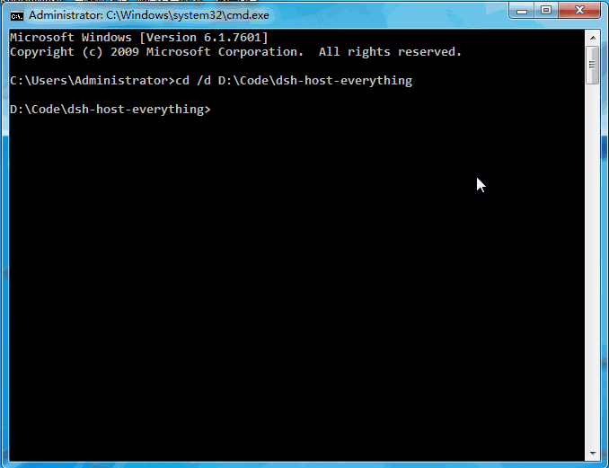

**This is not a framework, this is a protocol for the AI era.**

---

# dsh-host-everything

**一切皆主程序 (Everything is a Host Program)** — 一个零依赖、纯 TypeScript + Node.js 的
"统一程序调度总线"框架。

把系统底层原生能力（`cmd.exe` / `git` / `python`）、DSH 自身的内置工具、外部独立程序
（本地脚本 / 可执行文件）和远程服务（HTTP / JSON-RPC）全部抽象成同一种东西：
**主程序（Host）**。Agent 只需对总线说一句话 —— `run <host_id> [参数]` —— 总线负责
注册、路由、排队、超时、熔断与结果归一化。

> **设计信条**：如果任何能力都能用 `execute(params) → result` 描述，那么调度这些能力
> 的代码就只需要写一次。Agent 不需要知道 `git` 是进程、`fs` 是函数、`httpbin` 是网络
> 服务 —— 对 Agent 而言它们全是 `host`。

---

## 目录

- [架构总览（ASCII 图）](#架构总览)
- [快速开始](#快速开始)
- [一切皆主程序：哲学](#一切皆主程序哲学)
- [四类主程序](#四类主程序)
- [统一协议](#统一协议)
- [调度总线如何保证不崩](#调度总线如何保证不崩)
- [宿主启动器 HostCLI](#宿主启动器-hostcli)
- [配置文件](#配置文件)
- [在 Win7 下无痛运行（避坑指南）](#在-win7-下无痛运行避坑指南)
- [项目结构](#项目结构)
- [API 速查](#api-速查)
- [与 DeepSeek Harness 集成](#与-deepseek-harness-集成)
- [开发与测试](#开发与测试)
- [许可证](#许可证)

---

## 架构总览

```
                    ┌────────────────────────────────────────────────┐
                    │              Agent / 用户 / DSH                │
                    │   "run clock iso"  ·  JSON-RPC  ·  TCP        │
                    └───────────┬───────────────────────┬────────────┘
                                │                       │
                 ┌──────────────▼──────────┐  ┌─────────▼──────────┐
                 │  HostCLI (宿主启动器)    │  │  Library API       │
                 │  REPL / --rpc / --serve │  │  require('...')    │
                 └──────────────┬──────────┘  └─────────┬──────────┘
                                └──────────┬────────────┘
                                           │
                    ┌──────────────────────▼──────────────────────┐
                    │        HostDispatcher (统一调度总线)         │
                    │  意图解析 → 路由 → 异步队列 → 看门狗 → 归一化 │
                    │        dispatch() 永不抛出异常               │
                    └──────┬───────────────────────────────┬──────┘
                           │                               │
            ┌──────────────▼──────────┐       ┌────────────▼───────────┐
            │   TaskQueue (纯内存)     │       │   HostRegistry (注册中心)│
            │  并发限制 · 限量等待队列  │       │  register/unregister/   │
            │  cancel / drain          │       │  list / 事件通知        │
            └──────────────┬──────────┘       └────────────┬───────────┘
                           │                               │
         ┌─────────────────┴───────────────────────────────┴────────────┐
         │                       HostAdapter 适配器层                    │
         ├──────────────┬──────────────┬───────────────┬─────────────────┤
         │  CliHost     │  NodeHost    │  HttpHost     │  (BaseHost)     │
         │  child_      │  in-process  │  http/https   │  指标·状态·信封 │
         │  process     │  或 child    │  REST/JSON-RPC│                 │
         │  spawn       │  隔离        │  仅核心模块    │                 │
         └──────┬───────┴──────┬───────┴───────┬───────┴─────────────────┘
                │              │               │
    ╔═══════════▼══════════════▼═══════════════▼═════════════════════╗
    ║   system-native      dsh-builtin      standalone-app    external-service
    ║   cmd / git /        echo / clock /   example-greet /   httpbin /
    ║   powershell /       fs / env         win7-checkup /    JSON-RPC
    ║   python             (仓库内置)       任意 .exe/.js     远程 API
    ╚════════════════════════════════════════════════════════════════╝
```

**数据流**（一次调用的完整旅程）：

```
  run clock iso
      │
      ▼
 [HostCLI tokenize] ──► { hostId: 'clock', params: { args: ['iso'] } }
      │
      ▼
 [HostDispatcher.dispatch]
      │  ① 生成 taskId  ② 查 HostRegistry（未注册 → HOST_NOT_FOUND，不抛错）
      │  ③ 丢进 TaskQueue（排队 / 并发控制 / 超时计时）
      ▼
 [NodeHost.execute]  ──► builtin-time.js handler({ args: ['iso'] })
      │  返回值经 valueToResult() 归一化为标准信封
      ▼
 [BaseHost.trackResult]  ──► 记录 runs / failures / latency / 状态
      │
      ▼
 { ok: true, hostId: 'clock', stdout: '2026-…Z', data: '2026-…Z', durationMs: 2 }
```

---

## 快速开始

```bash
git clone <repo-url> dsh-host-everything
cd dsh-host-everything
npm install          # 只有 typescript 一个 devDependency，零运行时依赖
npm run build        # tsc → dist/
npm run smoke        # 冒烟测试（13 项断言，全过即健康）

# 交互式 REPL
npm start
hostbus> hosts
hostbus> run clock iso
hostbus> run greet --name World --lang zh
hostbus> stats
hostbus> exit

# 一次性调度（CI 友好，失败时退出码非 0）
node bin/hostbus.js run clock iso

# JSON-RPC over stdio（给 Agent / DSH 当子进程驱动）
node bin/hostbus.js --rpc

# JSON-RPC over TCP（给其他机器 / 工具调用）
node bin/hostbus.js --serve 127.0.0.1:8421
```

---

## 一切皆主程序：哲学

传统 Agent 框架的问题是**能力边界的形状不一致**：

| 能力 | 传统调用方式 | 出错时的表现 |
|---|---|---|
| 运行 `git status` | `child_process.exec(...)` | 进程挂起、stdout 爆缓冲 |
| 读时间 | 直接调函数 | 同步异常抛进调用栈 |
| 查远程 API | `fetch(...)` | 网络抖动、无超时 |
| DSH 内置工具 | 框架私有协议 | 与上面三者协议互不相通 |

本框架的回答是：**别给每类能力发明一套调用方式**。所有能力都实现同一个接口：

```ts
interface IHost {
  readonly id: string;
  readonly type: HostType;          // 四类之一
  execute(params): Promise<HostExecResult>;   // 永不抛出异常
  status(): HostStatus;             // 同步健康快照
  abort?(reason?: string): void;    // 可选：硬中止
  dispose?(): void | Promise<void>; // 可选：注销时清理
}
```

只要能 `execute` + `status`，它就是主程序。于是：

- **Agent 侧的认知负担归零**：记住 `run <id>` 就够了，参数 / 结果的形状全部一致。
- **总线侧的健壮性只写一次**：超时看门狗、并发队列、错误归一化、指标埋点，全部在
  `HostDispatcher` / `BaseHost` 里实现一次，四种适配器免费复用。
- **扩展时只用加适配器**：明天要接 gRPC？写一个 `GrpcHost` 实现 `execute` 即可，
  注册中心、队列、CLI、RPC 协议全都不用动。

这就是"微内核"式的取舍：**总线本身只做调度不做能力**，所有能力都以 Host 插件形式
挂在注册中心上。

---

## 四类主程序

| `type` | 含义 | 适配器 | 示例 |
|---|---|---|---|
| `system-native` | 操作系统自带的原生命令 | `CliHost`（child_process.spawn） | `cmd`、`powershell`、`git`、`node` |
| `dsh-builtin` | 总线自带的内置能力（纯 JS 模块） | `NodeHost` | `echo`、`clock`、`fs`、`env` |
| `standalone-app` | 独立编写的本地程序 / 脚本 | `CliHost` 或 `NodeHost` | `example-greet.js`、`win7-checkup.js` |
| `external-service` | 远程进程，网络可达 | `HttpHost`（仅核心 http/https） | REST 端点、JSON-RPC 服务 |

每类的差异只在**适配器**，协议层（params/result 信封）完全相同。

---

## 统一协议

**请求信封** `HostExecParams`：

```ts
{
  taskId?: string;                 // 总线自动生成，结果里回显
  args?: string[];                 // argv 风格参数（CLI hosts 消费）
  input?: string;                  // 原始 stdin（CLI hosts 消费）
  data?: unknown;                  // 结构化负载（Node hosts / HTTP body）
  cwd?: string;                    // 工作目录覆盖（CLI hosts）
  env?: Record<string, string>;    // 环境变量覆盖（合并到宿主环境之上）
  timeoutMs?: number;              // 单次超时：参数 > host 默认 > 总线默认(30s)
  parseJson?: boolean;             // 把 stdout 解析成 JSON 塞进 result.data
}
```

**响应信封** `HostExecResult`：

```ts
{
  ok: boolean;                     // 业务是否成功（非零退出码 / RPC error / HTTP 4xx+ → false）
  hostId: string;                  // 来源主机
  taskId?: string;
  exitCode?: number;               // 进程退出码（进程型 hosts）
  stdout: string;                  // 人类可读主输出
  stderr: string;                  // 诊断输出
  data?: unknown;                  // 结构化返回值
  error?: { code: string; message: string };  // 机器可读错误
  durationMs: number;
  timedOut?: boolean;
}
```

**错误码表**（全部定义在 `HostErrorCode`，跨适配器稳定）：

`HOST_NOT_FOUND` · `TIMEOUT` · `ABORTED` · `QUEUE_FULL` · `QUEUE_DRAINED` ·
`SPAWN_FAILED` · `EXIT_CODE` · `HOST_ERROR` · `INVALID_PARAMS` · `NETWORK` ·
`HTTP_STATUS`（实际为 `HTTP_404` 这类带状态码的形式） · `SHUTDOWN`

---

## 调度总线如何保证不崩

1. **`dispatch()` 永不抛出异常** —— 未知 host、参数畸形、host 抛错，全部被归一化成
   `ok: false` 的结构化结果（三道防线：`BaseHost.caughtResult` → `NodeHost` 子进程
   隔离 → `HostDispatcher` 的 try/catch）。
2. **双层超时看门狗** —— 外层 `HostDispatcher` 用 `Promise.race` 计时，超时后调用
   `host.abort()` 硬中止；适配器内部（如 `CliHost`）还有自己的 `setTimeout` 兜底，
   杀掉卡死的子进程。两层都已验证：冒烟测试里故意跑一个 60 秒的 host，600ms 内被
   干掉，总线继续服务。
3. **纯内存异步队列** —— `TaskQueue` 限并发（默认 4）、限量等待（默认 256，超限
   `QUEUE_FULL`）、支持 `cancel` / `clear` / `drain`。一个 host 卡死只会占用一个
   并发槽，永远不会饿死总线。没有 Redis，没有外部 broker。
4. **子进程隔离** —— `NodeHost` 的 `isolation: 'child'` 模式把模块 fork 进独立进程
   崩溃、死循环、内存泄漏都关在总线进程之外（通过 `bridge/node-runner.js` 的 stdio
   JSON 握手协议通信）。

---

## 宿主启动器 HostCLI

一个进程，三种入口：

```bash
# ① 交互式 REPL —— 人用
hostbus> run git --version
hostbus> status git
hostbus> stats                     # 总线级统计：dispatched/succeeded/timeouts/active…
hostbus> cancel <taskId>
hostbus> help

# ② JSON-RPC over stdio —— Agent / DSH 用（每行一个请求）
echo '{"jsonrpc":"2.0","id":1,"method":"run","params":{"hostId":"clock","params":{"args":["iso"]}}}' \
  | node bin/hostbus.js --rpc

# 方法列表：run / dispatch / hosts / status / stats / cancel / shutdown / ping / help

# ③ JSON-RPC over TCP —— 其他机器 / 工具用
node bin/hostbus.js --serve 127.0.0.1:8421
```

REPL 支持类 shell 分词：`run cmd echo "hello world"` 里的引号与转义由 `tokenize()`
处理；结构化参数可以 `run fs --json '{"op":"stat","path":"…"}'` 传给 `params.data`。

---

## 配置文件

声明式配置（CommonJS），复制 `config/hosts.example.js` 为 `config/hosts.config.js`
（后者被 git 忽略）即可自定义。每个条目变成总线上的一个 Host：

```js
module.exports = [
  { id: 'git', type: 'system-native', command: 'git', timeoutMs: 30_000 },
  { id: 'clock', type: 'dsh-builtin', modulePath: '../hosts/builtin-time.js' },
  {
    id: 'greet',
    type: 'standalone-app',
    command: process.execPath,                    // 显式走 node，跨平台一致
    baseArgs: [require('path').join(__dirname, '..', 'hosts', 'example-greet.js'), '--json'],
    timeoutMs: 10_000,
  },
  // {
  //   id: 'example-rpc', type: 'external-service',
  //   url: 'http://127.0.0.1:4000/api', rpc: 'json-rpc', jsonRpcMethod: 'ping',
  // },
];
```

相对路径一律按**配置文件所在目录**解析，配置文件随仓库移动无需改动。

---

## 在 Win7 下无痛运行（避坑指南）

本框架从第一行代码就按 Win7 兼容设计，以下是踩过并已回避的坑：

**1. 零原生编译 —— 绝不碰 node-gyp**
- 不用任何 C++ Addon。全部能力来自 Node 核心模块（`child_process` / `http` /
  `https` / `net` / `fs` / `readline` / `events`）+ 纯 JS。
- 不依赖 Docker、不依赖 Redis、不依赖任何本地常驻服务。`TaskQueue` 是纯内存实现。
- `npm install` 只装一个 devDependency（TypeScript）；**运行时零依赖**。

**2. Windows 不能直接 spawn `.js` 文件**
- `spawn('./tool.js')` 在 Windows 上报 `EFTYPE`（没有 shebang 关联）。
- 框架已内置规避：`CliHost.resolveSpawnTarget()` 检测 `.js/.cjs/.mjs` 入口，自动改用
  `process.execPath`（当前 Node）运行——配置里写 `command: './tool.js'` 也能工作。
- 示例配置里的 `greet` 则更进一步，显式写 `command: process.execPath`，POSIX 与
  Windows 行为完全一致。

**3. PowerShell / cmd 的退出码与 stdio**
- `CliHost` 对非零退出码返回 `ok:false` 但**仍然附上 stdout/stderr**，调试不丢信息。
- spawn 失败（`ENOENT`，命令不在 PATH）会提示"usually means the command is not on
  PATH"，而不是一个无意义的 `errno`。
- 所有子进程 `windowsHide: true`，不弹黑窗。

**4. 输出缓冲爆炸**
- 每条流 8 MiB 上限，超限截断并追加截断标记，避免 GB 级 stdout 拖垮总线。

**5. Node 版本与 TypeScript**
- 运行时只要求 `node >= 12`，用的全是稳定核心 API。
- **编者注（本机实测）**：若你的 npm 镜像提供的 `typescript` 7.x 包是只有 `version`
  导出的桩（`tsc` 一跑就崩），把 devDependency 锁在 `^5.9.3` 即可——本项目自带
  `scripts/build.js`（用编译器 API 在进程内编译），不依赖 `tsc` CLI。
- `npm run build` 用的是 in-process 编译脚本（`node scripts/build.js`），刻意绕开
  任何 CLI 入口，在 weird 环境下更可控。

**6. Win7 体检工具**
- `hosts/win7-checkup.js`（`run win7-checkup`）是个**只读**体检探针：内存余量、
  负载、运行时长、系统版本号。不写注册表、不改系统，可以放心跑在任何古董机上。

---

## 项目结构

```
dsh-host-everything/
├── bin/
│   └── hostbus.js               # 启动器：REPL / --rpc / --serve / run / hosts
├── bridge/
│   └── node-runner.js           # 子进程隔离桥（被 fork，纯 CommonJS，不经 TS 编译）
├── config/
│   ├── hosts.example.js         # 示例配置（10 个主机，git-ignored 的 .config.js 由此复制）
│   └── hosts.config.js          # 你的本地配置（不入 git）
├── hosts/                       # 主程序实现（纯 CommonJS，注册中心可直接 require）
│   ├── builtin-echo.js          #   dsh-builtin: 回显
│   ├── builtin-time.js          #   dsh-builtin: clock
│   ├── builtin-fs.js            #   dsh-builtin: 只读 fs 探查（1 MiB 上限）
│   ├── builtin-env.js           #   dsh-builtin: 环境诊断 + which
│   ├── example-greet.js         #   standalone-app: JSON 问候生成器
│   └── win7-checkup.js          #   standalone-app: Win7 只读体检
├── scripts/
│   ├── build.js                 # in-process TypeScript 编译（不依赖 tsc CLI）
│   └── smoke.js                 # 冒烟测试（13 项断言，覆盖全部适配器 + 故障注入）
├── src/
│   ├── core/
│   │   ├── types.ts             #   契约：IHost / HostExecParams / HostExecResult / 错误码 / 事件
│   │   ├── errors.ts            #   HostError + describeError + failedResult
│   │   ├── HostRegistry.ts      #   注册中心：动态注册/注销/查询/事件
│   │   ├── TaskQueue.ts         #   纯内存并发受限 FIFO
│   │   └── HostDispatcher.ts    #   统一调度总线：路由/队列/看门狗/熔断/统计
│   ├── adapters/
│   │   ├── BaseHost.ts          #   适配器基类：指标/状态/信封组装
│   │   ├── CliHost.ts           #   CLI 适配器：spawn 任意命令行程序
│   │   ├── NodeHost.ts          #   Node 适配器：in-process 或 child 隔离
│   │   └── HttpHost.ts          #   HTTP 适配器：REST / JSON-RPC（仅核心模块）
│   ├── cli/
│   │   └── HostCLI.ts           #   REPL + JSON-RPC stdio + TCP 三合一
│   ├── config/
│   │   └── loader.ts            #   声明式配置 → 总线
│   ├── util/
│   │   └── values.ts            #   handler 返回值 → 结果信封
│   └── index.ts                 #   公共 API 出口
├── package.json
├── tsconfig.json
└── README.md
```

---

## API 速查

```ts
import {
  HostRegistry, TaskQueue, HostDispatcher,
  CliHost, NodeHost, HttpHost, HostCLI, buildRegistry,
} from 'dsh-host-everything';

// 动态注册（编程式）
const registry = new HostRegistry();
registry.register(new CliHost({ id: 'git', command: 'git' }));
registry.register(new NodeHost({ id: 'my-tool', modulePath: './tool.js', isolation: 'child' }));
registry.unregister('git');                    // 异步 dispose，不阻塞

// 调度
const bus = new HostDispatcher({ registry, concurrency: 4, defaultTimeoutMs: 30_000 });
const result = await bus.dispatch({
  hostId: 'git',
  params: { args: ['status'], timeoutMs: 5_000, parseJson: false },
});
if (!result.ok) console.log(result.error?.code, result.error?.message);

const stats = bus.stats();                     // { dispatched, succeeded, failed, timeouts, active, pending, hosts, uptimeMs }
await bus.cancel(taskId);                      // 只取消排队中的任务
await bus.shutdown();                          // 清队列 → drain → 注销全部 host

// 事件
bus.on('dispatch:timeout', ({ taskId, hostId }) => alert(taskId, hostId));
```

---

## 与 DeepSeek Harness 集成

总线对 DSH 而言就是一个**被 child_process 包装的外部程序**——正是
`standalone-app` 哲学的自我应用：

```bash
# DSH 侧把总线当一个长驻子进程驱动（JSON-RPC over stdio）
node bin/hostbus.js --rpc
```

每行一个 JSON-RPC 2.0 请求（`run` / `hosts` / `status` / `stats` / `cancel` / …），
每行一个响应。DSH 不需要知道总线的内部结构，就像总线不需要知道 `git` 的内部结构。
反过来，DSH 自身的工具也可以被包装成 `dsh-builtin` 主程序挂到总线上——两个方向都
是同一个协议。

由于协议是行的、无状态的、JSON 的，任何 Agent 框架（不只 DSH）都能用同样方式接入。

---

## 开发与测试

```bash
npm run build       # node scripts/build.js —— in-process tsc 编译 → dist/
npm run typecheck   # 同上但只检查（脚本内含诊断输出）
npm run smoke       # 端到端冒烟测试
npm run repl        # 启动 REPL
npm run rpc         # 启动 stdio JSON-RPC
npm run serve       # 启动 TCP JSON-RPC（127.0.0.1:8421）
```

**冒烟测试覆盖**（`scripts/smoke.js`，13 项断言）：配置装载 → 内置主机（echo/clock/
fs/env）→ system-native CLI → standalone CLI → 子进程隔离的时间上界 → 未知 host 的
结构化失败 → 看门狗超时杀子进程 → 故障注入后总线仍健康 → 统计计数。

测试全是**故障注入式**的：我们故意造一个 60 秒不退出的 host、一个不存在的 host，
 assertion 是"总线 Survive 并给出结构化错误"，而不是" happy path 跑通"。

---

## 许可证

MIT —— 见 [LICENSE](LICENSE)。
